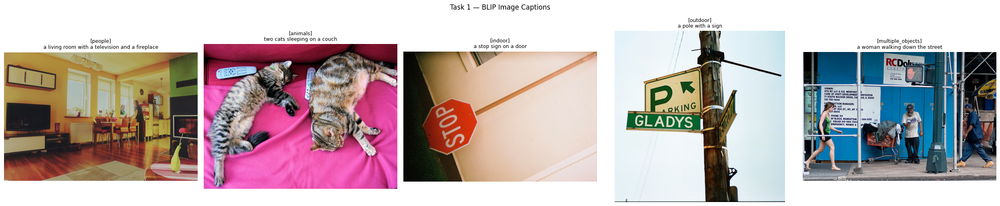
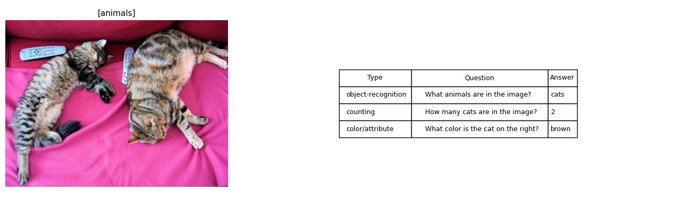
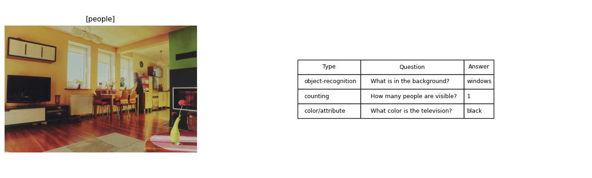
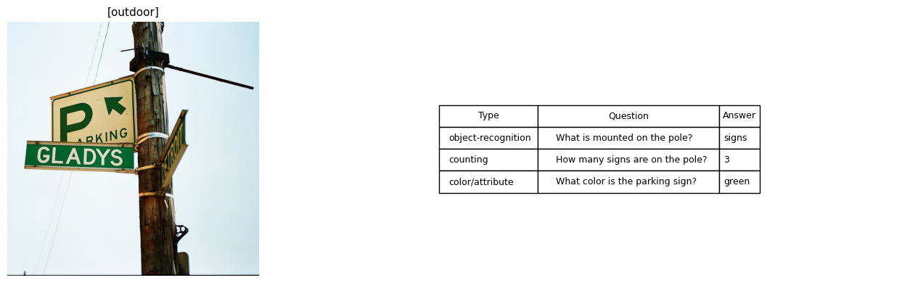
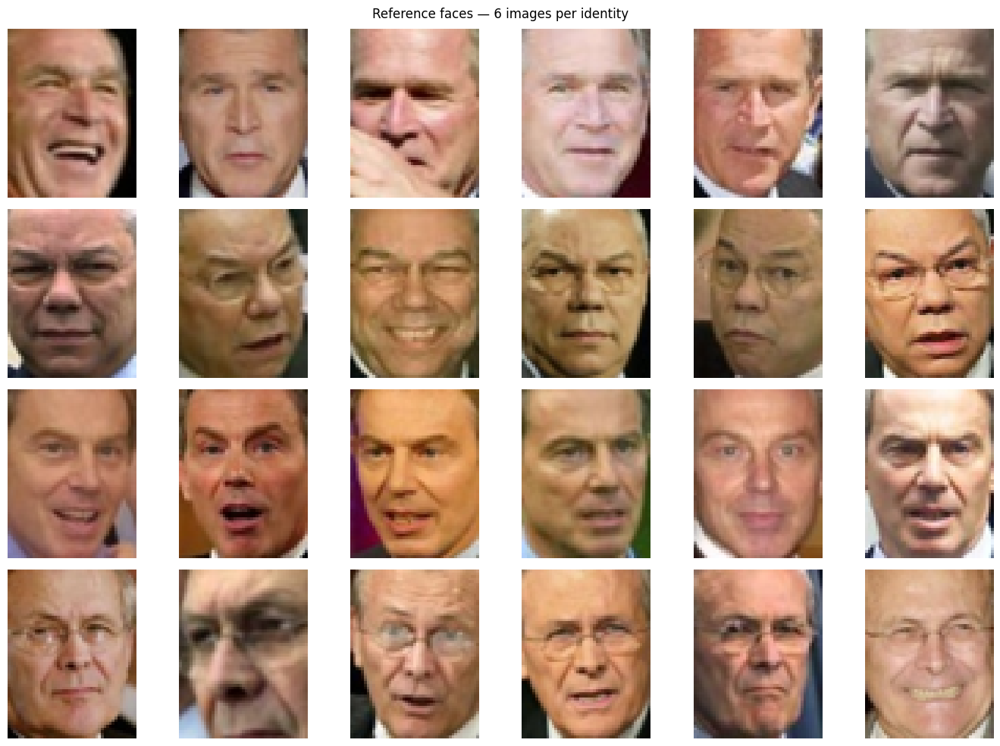
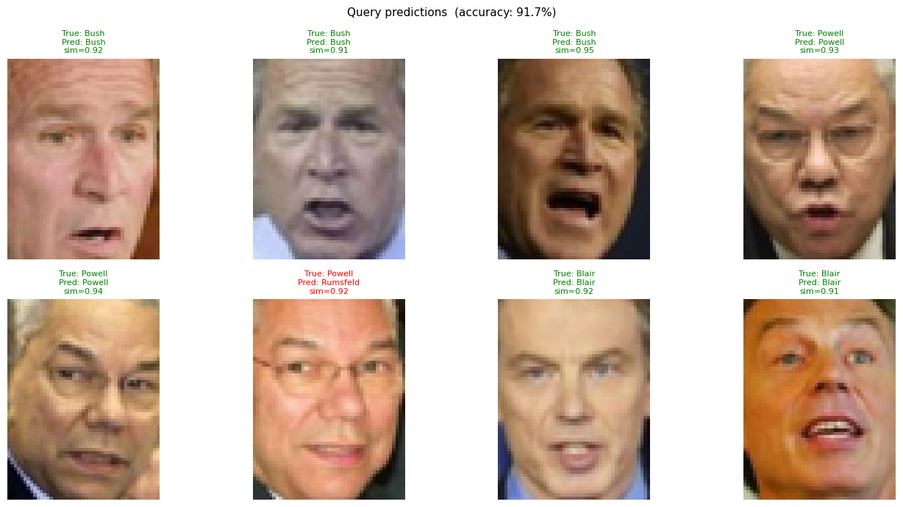
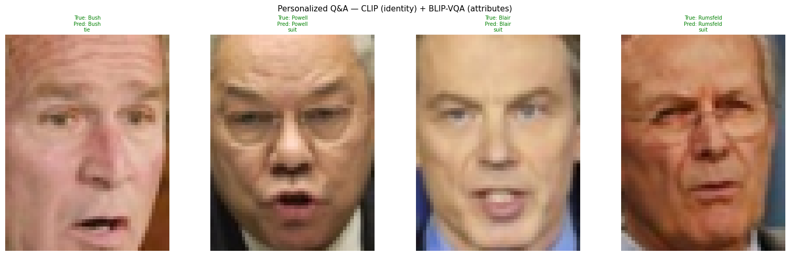

# Homework: Multimodal Models - Image Captioning and Visual Question Answering

**Goal**

In this assignment, you will experiment with multimodal models that combine vision and language.

You will use a pretrained model to:

1. Generate a caption for an image.
2. Answer questions about an image.

You will also analyze the model's strengths, weaknesses, and possible failure cases.

## Setup (run first)

> **Before running:** make sure you are on a **GPU runtime** in Colab  
> (Runtime → Change runtime type → L4 / T4 GPU).
>
> Make sure you have a Colab Secret named **`FOLDER_ID`** containing the ID of your  
> Google Drive folder (the long string after `/folders/` in the folder URL).  
> Enable notebook access to it via the 🔑 icon in the left sidebar.
>
> Then run the three cells below in order.


```python
# Install required packages (torch, numpy, google-api-python-client already on Colab)
!pip install -q transformers pillow requests scikit-learn matplotlib pandas
```


```python
import os, io, csv, requests
import numpy as np
import torch
import matplotlib.pyplot as plt
import matplotlib.patches as mpatches
import pandas as pd
from PIL import Image

device = "cuda" if torch.cuda.is_available() else "cpu"
print(f"✓ Device: {device}")
if device == "cpu":
    print("  ⚠ No GPU detected — models will be slow. Check Runtime → Change runtime type.")
```

    ✓ Device: cuda


```python
# ── Google Drive persistence ─────────────────────────────────────────────────
# Tries drive.file scope first (restricted: only files this app creates).
# Falls back to standard full-Drive auth on older Colab versions.
#
# Uses google-api-python-client (pre-installed on Colab — no extra pip needed).
# Reads your folder ID from a Colab Secret named FOLDER_ID.

import os

_drive_service = None   # googleapiclient Drive v3 service
_folder_id     = None   # destination folder ID
_drive_ready   = False  # set to True after successful init


def _init_drive():
    global _drive_service, _folder_id, _drive_ready

    # ── Detect Colab ──────────────────────────────────────────────────────────
    try:
        import google.colab          # noqa – just testing import
        IN_COLAB = True
    except ImportError:
        IN_COLAB = False

    if not IN_COLAB:
        print("Not running in Colab — Drive saves will be skipped.")
        return

    # ── Read folder ID from Colab Secret ─────────────────────────────────────
    try:
        from google.colab import userdata
        _folder_id = userdata.get('FOLDER_ID')
        if not _folder_id:
            raise ValueError("Secret value is empty")
        print(f"✓ FOLDER_ID read from secret: {_folder_id[:8]}…")
    except Exception as e:
        print(f"⚠  Could not read FOLDER_ID secret: {e}")
        print("   → In Colab: click 🔑 in the left sidebar → New secret")
        print("     Name: FOLDER_ID  |  Value: <your folder ID>")
        return

    # ── Authenticate ──────────────────────────────────────────────────────────
    from google.colab import auth as colab_auth

    try:
        # Newer Colab: request only drive.file scope (restricted — app-created files only)
        colab_auth.authenticate_user(scopes=['https://www.googleapis.com/auth/drive.file'])
        print("✓ Authenticated with restricted scope (drive.file)")
    except TypeError:
        # Older Colab: scopes parameter not supported — fall back to full Drive auth
        colab_auth.authenticate_user()
        print("✓ Authenticated (standard scope — older Colab version)")

    # ── Build Drive API client ────────────────────────────────────────────────
    try:
        import google.auth
        from googleapiclient.discovery import build

        creds, _ = google.auth.default()
        _drive_service = build('drive', 'v3', credentials=creds)
        _drive_ready = True
        print("✓ Drive ready — uploads will go to your folder")
    except Exception as e:
        print(f"⚠  Drive API init failed: {e}")
        print("   Files will be saved locally in /content/ only.")


def save_to_drive(local_path: str):
    """Upload a local file to the configured Drive folder.
    Safe to call even if Drive init failed — prints a warning and continues.
    """
    global _drive_ready
    if not _drive_ready:
        _init_drive()          # lazy init on first call

    fname = os.path.basename(local_path)

    if not _drive_ready:
        print(f"  (Drive not configured — '{fname}' saved locally only)")
        return

    try:
        from googleapiclient.http import MediaFileUpload
        metadata = {'name': fname, 'parents': [_folder_id]}
        media    = MediaFileUpload(local_path, resumable=False)
        result   = _drive_service.files().create(
                       body=metadata, media_body=media, fields='id'
                   ).execute()
        print(f"  ↑ Saved to Drive: {fname}  (id: {result['id'][:12]}…)")
    except Exception as e:
        print(f"  ⚠  Upload failed for '{fname}': {e}")


# ── Initialise now so the auth popup appears before any task cell runs ────────
_init_drive()
```

    ✓ FOLDER_ID read from secret: 1A181OZr…
    ✓ Authenticated (standard scope — older Colab version)
    ✓ Drive ready — uploads will go to your folder


## Task 1 - Image Captioning (30 Points)

**Description**

Given an input image, use a pretrained multimodal model to generate a textual description of the image.

Example:

**Input**: An image of a dog running in a park.

**Output**: A dog is running on grass in a park.

**Requirements**

Use at least 5 different images.

The images should include:

* At least one image with people
* At least one image with animals
* At least one indoor scene
* At least one outdoor scene
* At least one image with multiple objects

You may use your own images or images from an open dataset.

**Suggested Models**

You may use one of the following:

* Salesforce/blip-image-captioning-base
* Salesforce/blip-image-captioning-large
* microsoft/git-base
* Any other image-captioning model from HuggingFace

**Deliverables**

1. Present your images and model captions clearly

    Display each image together with the caption generated by the model.

2. Analyze model failures

    Choose at least 2 examples where the model made a mistake or gave an incomplete caption.

    For each example, explain:

    * What the model predicted
    * What the correct description should be
    * Why the model may have failed

    For example :

    "The model described the image as “a person sitting at a table,” but it missed the laptop and the coffee cup.
    This may have happened because the person was the most visually dominant object, while the smaller objects were less noticeable."


```python
# ── Task 1 · Load BLIP Image Captioning Model ────────────────────────────────
from transformers import BlipProcessor, BlipForConditionalGeneration

print("Loading BLIP image captioning model…  (first run downloads ~1 GB)")
caption_processor = BlipProcessor.from_pretrained("Salesforce/blip-image-captioning-base")
caption_model = (BlipForConditionalGeneration
                 .from_pretrained("Salesforce/blip-image-captioning-base")
                 .to(device))
caption_model.eval()
print("✓ Model ready on", device)
```

    Loading BLIP image captioning model…  (first run downloads ~1 GB)


    /usr/local/lib/python3.12/dist-packages/huggingface_hub/utils/_auth.py:112: UserWarning: 
    The secret `HF_TOKEN` does not exist in your Colab secrets.
    To authenticate with the Hugging Face Hub, create a token in your settings tab (https://huggingface.co/settings/tokens), set it as secret in your Google Colab and restart your session.
    You will be able to reuse this secret in all of your notebooks.
    Please note that authentication is recommended but still optional to access public models or datasets.
      warnings.warn(
    Warning: You are sending unauthenticated requests to the HF Hub. Please set a HF_TOKEN to enable higher rate limits and faster downloads.
    WARNING:huggingface_hub.utils._http:Warning: You are sending unauthenticated requests to the HF Hub. Please set a HF_TOKEN to enable higher rate limits and faster downloads.


    preprocessor_config.json:   0%|          | 0.00/287 [00:00<?, ?B/s]


    The image processor of type `BlipImageProcessor` is now loaded as a fast processor by default, even if the model checkpoint was saved with a slow processor. This is a breaking change and may produce slightly different outputs. To continue using the slow processor, instantiate this class with `use_fast=False`. 


    config.json:   0%|          | 0.00/4.56k [00:00<?, ?B/s]


    tokenizer_config.json:   0%|          | 0.00/506 [00:00<?, ?B/s]


    vocab.txt:   0%|          | 0.00/232k [00:00<?, ?B/s]


    tokenizer.json:   0%|          | 0.00/711k [00:00<?, ?B/s]


    special_tokens_map.json:   0%|          | 0.00/125 [00:00<?, ?B/s]


    pytorch_model.bin:   0%|          | 0.00/990M [00:00<?, ?B/s]


    Loading weights:   0%|          | 0/473 [00:00<?, ?it/s]


    The tied weights mapping and config for this model specifies to tie text_decoder.cls.predictions.bias to text_decoder.cls.predictions.decoder.bias, but both are present in the checkpoints, so we will NOT tie them. You should update the config with `tie_word_embeddings=False` to silence this warning
    The tied weights mapping and config for this model specifies to tie text_decoder.bert.embeddings.word_embeddings.weight to text_decoder.cls.predictions.decoder.weight, but both are present in the checkpoints, so we will NOT tie them. You should update the config with `tie_word_embeddings=False` to silence this warning
    BlipForConditionalGeneration LOAD REPORT from: Salesforce/blip-image-captioning-base
    Key                                       | Status     |  | 
    ------------------------------------------+------------+--+-
    text_decoder.bert.embeddings.position_ids | UNEXPECTED |  | 
    
    Notes:
    - UNEXPECTED	:can be ignored when loading from different task/architecture; not ok if you expect identical arch.


    ✓ Model ready on cuda


```python
# ── Task 1 · Images & Captions ───────────────────────────────────────────────
# Five COCO val2017 images — one per required category.
# Replace any URL with your own image if you prefer.

IMAGE_URLS = {
    "people":           "http://images.cocodataset.org/val2017/000000000139.jpg",
    "animals":          "http://images.cocodataset.org/val2017/000000039769.jpg",
    "indoor":           "http://images.cocodataset.org/val2017/000000297343.jpg",
    "outdoor":          "http://images.cocodataset.org/val2017/000000058636.jpg",
    "multiple_objects": "http://images.cocodataset.org/val2017/000000252219.jpg",
}

# ── Helpers ───────────────────────────────────────────────────────────────────

def download_image(url):
    try:
        r = requests.get(url, timeout=15)
        r.raise_for_status()
        return Image.open(io.BytesIO(r.content)).convert("RGB")
    except Exception as e:
        print(f"  ⚠ Download failed ({url}): {e}")
        return None

def generate_caption(image):
    inputs = caption_processor(image, return_tensors="pt").to(device)
    with torch.no_grad():
        ids = caption_model.generate(**inputs, max_new_tokens=50)
    return caption_processor.decode(ids[0], skip_special_tokens=True)

# ── Generate captions ─────────────────────────────────────────────────────────

results = []
for category, url in IMAGE_URLS.items():
    print(f"[{category}] downloading…", end=" ")
    img = download_image(url)
    if img is None:
        continue
    caption = generate_caption(img)
    results.append({"category": category, "caption": caption, "image": img})
    print(f'→ "{caption}"')

# ── Gallery ───────────────────────────────────────────────────────────────────

n = len(results)
fig, axes = plt.subplots(1, n, figsize=(5 * n, 5))
axes = [axes] if n == 1 else list(axes)

for ax, row in zip(axes, results):
    ax.imshow(row["image"])
    ax.set_title(f"[{row['category']}]\n{row['caption']}", fontsize=9, pad=6)
    ax.axis("off")

plt.suptitle("Task 1 — BLIP Image Captions", fontsize=12, y=1.02)
plt.tight_layout()

gallery_path = "/content/task1_gallery.png"
plt.savefig(gallery_path, dpi=120, bbox_inches="tight")
plt.show()
save_to_drive(gallery_path)

# ── Summary table + CSV ───────────────────────────────────────────────────────

df_captions = pd.DataFrame([
    {"Category": r["category"], "Caption": r["caption"]} for r in results
])
print("\n── Caption Summary ──────────────────────────────────────────────")
try:
    display(df_captions)
except NameError:
    print(df_captions.to_string(index=False))

csv_path = "/content/task1_captions.csv"
df_captions.to_csv(csv_path, index=False)
save_to_drive(csv_path)
print("✓ Gallery and CSV saved.")
```

    [people] downloading… → "a living room with a television and a fireplace"
    [animals] downloading… → "two cats sleeping on a couch"
    [indoor] downloading… → "a stop sign on a door"
    [outdoor] downloading… → "a pole with a sign"
    [multiple_objects] downloading… → "a woman walking down the street"


    

    


      ⚠  Upload failed for 'task1_gallery.png': EOF occurred in violation of protocol (_ssl.c:2427)
    
    ── Caption Summary ──────────────────────────────────────────────


  <div id="df-a85fde4c-3eef-44cc-924f-be9a2a9a012a" class="colab-df-container">
    <div>
<style scoped>
    .dataframe tbody tr th:only-of-type {
        vertical-align: middle;
    }

    .dataframe tbody tr th {
        vertical-align: top;
    }

    .dataframe thead th {
        text-align: right;
    }
</style>
<table border="1" class="dataframe">
  <thead>
    <tr style="text-align: right;">
      <th></th>
      <th>Category</th>
      <th>Caption</th>
    </tr>
  </thead>
  <tbody>
    <tr>
      <th>0</th>
      <td>people</td>
      <td>a living room with a television and a fireplace</td>
    </tr>
    <tr>
      <th>1</th>
      <td>animals</td>
      <td>two cats sleeping on a couch</td>
    </tr>
    <tr>
      <th>2</th>
      <td>indoor</td>
      <td>a stop sign on a door</td>
    </tr>
    <tr>
      <th>3</th>
      <td>outdoor</td>
      <td>a pole with a sign</td>
    </tr>
    <tr>
      <th>4</th>
      <td>multiple_objects</td>
      <td>a woman walking down the street</td>
    </tr>
  </tbody>
</table>
</div>
    <div class="colab-df-buttons">

  <div class="colab-df-container">
    <button class="colab-df-convert" onclick="convertToInteractive('df-a85fde4c-3eef-44cc-924f-be9a2a9a012a')"
            title="Convert this dataframe to an interactive table."
            style="display:none;">

  <svg xmlns="http://www.w3.org/2000/svg" height="24px" viewBox="0 -960 960 960">
    <path d="M120-120v-720h720v720H120Zm60-500h600v-160H180v160Zm220 220h160v-160H400v160Zm0 220h160v-160H400v160ZM180-400h160v-160H180v160Zm440 0h160v-160H620v160ZM180-180h160v-160H180v160Zm440 0h160v-160H620v160Z"/>
  </svg>
    </button>

  <style>
    .colab-df-container {
      display:flex;
      gap: 12px;
    }

    .colab-df-convert {
      background-color: #E8F0FE;
      border: none;
      border-radius: 50%;
      cursor: pointer;
      display: none;
      fill: #1967D2;
      height: 32px;
      padding: 0 0 0 0;
      width: 32px;
    }

    .colab-df-convert:hover {
      background-color: #E2EBFA;
      box-shadow: 0px 1px 2px rgba(60, 64, 67, 0.3), 0px 1px 3px 1px rgba(60, 64, 67, 0.15);
      fill: #174EA6;
    }

    .colab-df-buttons div {
      margin-bottom: 4px;
    }

    [theme=dark] .colab-df-convert {
      background-color: #3B4455;
      fill: #D2E3FC;
    }

    [theme=dark] .colab-df-convert:hover {
      background-color: #434B5C;
      box-shadow: 0px 1px 3px 1px rgba(0, 0, 0, 0.15);
      filter: drop-shadow(0px 1px 2px rgba(0, 0, 0, 0.3));
      fill: #FFFFFF;
    }
  </style>

    <script>
      const buttonEl =
        document.querySelector('#df-a85fde4c-3eef-44cc-924f-be9a2a9a012a button.colab-df-convert');
      buttonEl.style.display =
        google.colab.kernel.accessAllowed ? 'block' : 'none';

      async function convertToInteractive(key) {
        const element = document.querySelector('#df-a85fde4c-3eef-44cc-924f-be9a2a9a012a');
        const dataTable =
          await google.colab.kernel.invokeFunction('convertToInteractive',
                                                    [key], {});
        if (!dataTable) return;

        const docLinkHtml = 'Like what you see? Visit the ' +
          '<a target="_blank" href=https://colab.research.google.com/notebooks/data_table.ipynb>data table notebook</a>'
          + ' to learn more about interactive tables.';
        element.innerHTML = '';
        dataTable['output_type'] = 'display_data';
        await google.colab.output.renderOutput(dataTable, element);
        const docLink = document.createElement('div');
        docLink.innerHTML = docLinkHtml;
        element.appendChild(docLink);
      }
    </script>
  </div>


  <div id="id_8eb6470c-48f0-47db-8b4a-667ba6bded1d">
    <style>
      .colab-df-generate {
        background-color: #E8F0FE;
        border: none;
        border-radius: 50%;
        cursor: pointer;
        display: none;
        fill: #1967D2;
        height: 32px;
        padding: 0 0 0 0;
        width: 32px;
      }

      .colab-df-generate:hover {
        background-color: #E2EBFA;
        box-shadow: 0px 1px 2px rgba(60, 64, 67, 0.3), 0px 1px 3px 1px rgba(60, 64, 67, 0.15);
        fill: #174EA6;
      }

      [theme=dark] .colab-df-generate {
        background-color: #3B4455;
        fill: #D2E3FC;
      }

      [theme=dark] .colab-df-generate:hover {
        background-color: #434B5C;
        box-shadow: 0px 1px 3px 1px rgba(0, 0, 0, 0.15);
        filter: drop-shadow(0px 1px 2px rgba(0, 0, 0, 0.3));
        fill: #FFFFFF;
      }
    </style>
    <button class="colab-df-generate" onclick="generateWithVariable('df_captions')"
            title="Generate code using this dataframe."
            style="display:none;">

  <svg xmlns="http://www.w3.org/2000/svg" height="24px"viewBox="0 0 24 24"
       width="24px">
    <path d="M7,19H8.4L18.45,9,17,7.55,7,17.6ZM5,21V16.75L18.45,3.32a2,2,0,0,1,2.83,0l1.4,1.43a1.91,1.91,0,0,1,.58,1.4,1.91,1.91,0,0,1-.58,1.4L9.25,21ZM18.45,9,17,7.55Zm-12,3A5.31,5.31,0,0,0,4.9,8.1,5.31,5.31,0,0,0,1,6.5,5.31,5.31,0,0,0,4.9,4.9,5.31,5.31,0,0,0,6.5,1,5.31,5.31,0,0,0,8.1,4.9,5.31,5.31,0,0,0,12,6.5,5.46,5.46,0,0,0,6.5,12Z"/>
  </svg>
    </button>
    <script>
      (() => {
      const buttonEl =
        document.querySelector('#id_8eb6470c-48f0-47db-8b4a-667ba6bded1d button.colab-df-generate');
      buttonEl.style.display =
        google.colab.kernel.accessAllowed ? 'block' : 'none';

      buttonEl.onclick = () => {
        google.colab.notebook.generateWithVariable('df_captions');
      }
      })();
    </script>
  </div>

    </div>
  </div>


      ↑ Saved to Drive: task1_captions.csv  (id: 1mlINe_7ahhJ…)
    ✓ Gallery and CSV saved.


```python
save_to_drive("/content/task1_gallery.png")
```

      ↑ Saved to Drive: task1_gallery.png  (id: 1xvLjNgDZPH0…)


### Task 1 — Failure Analysis

I ran BLIP on 5 images and the results were mostly reasonable, but two cases stood out as clear failures worth examining.

---

**Failure 1 — The people got ignored**

The "people" image shows a living room with people in it, but BLIP returned: *"a living room with a television and a fireplace"*. There's no mention of the people at all. Looking at the image, the background furniture takes up most of the frame — the TV and fireplace are large and visually prominent, while the people are smaller. It seems like BLIP latched onto the most visually dominant objects and never paid attention to the actual subjects. The correct description should mention the people as the main subject of the scene.

---

**Failure 2 — Invented a door that isn't there**

For the indoor image, BLIP returned: *"a stop sign on a door"* — but there's no door anywhere in the image. This is a hallucination: the model invented something that doesn't exist. My guess is that stop signs in training data often appear near building entrances or doorways, so the model associated them and generated a confident but completely wrong caption. The correct description is just a stop sign mounted on a pole.

> Worth noting: the model described the outdoor pole as having "a sign" (singular), when there are actually 3 signs on it. BLIP seems to consistently struggle with counting, which makes sense — counting requires understanding the full scene rather than picking up on local visual patterns.

## Task 2 - Visual Question Answering (30 points)

**Description**

Given an image and a natural-language question, use a pretrained multimodal model to answer the question.

Example:

**Input image**: A kitchen scene

**Question**: How many chairs are visible?

**Output**: Four.

**Requirements**

Use at least 3 images.

For each image, ask at least 3 questions.

Your questions should include:

* One object-recognition question
* One counting question
* One color or attribute question

Example questions:
* What animal is in the image?
* How many people are visible?
* What color is the car?

**Suggested Models**

You may use:

* Salesforce/blip-vqa-base
* Salesforce/blip-vqa-capfilt-large
* Any other VQA model from HuggingFace

**Deliverables**

1. Present your images, questions and model's answers clearly

    Display each image together with the Q&A generated by the model.

2. Analyze model failures

    Choose at least 2 examples where the model made a mistake or gave an incomplete caption.

    For each example, explain:

    * What the model predicted
    * What the correct description should be
    * Why the model may have failed

    **You are required to find examples where it fails and analyse why**


```python
# ── Task 2 · Load BLIP VQA Model ─────────────────────────────────────────────
from transformers import BlipForQuestionAnswering

print("Loading BLIP VQA model…  (weights are shared with captioning — fast if already cached)")
vqa_processor = BlipProcessor.from_pretrained("Salesforce/blip-vqa-base")
vqa_model = (BlipForQuestionAnswering
             .from_pretrained("Salesforce/blip-vqa-base")
             .to(device))
vqa_model.eval()
print("✓ BLIP VQA model ready on", device)
```

    Loading BLIP VQA model…  (weights are shared with captioning — fast if already cached)


    preprocessor_config.json:   0%|          | 0.00/445 [00:00<?, ?B/s]


    config.json:   0%|          | 0.00/4.56k [00:00<?, ?B/s]


    tokenizer_config.json:   0%|          | 0.00/592 [00:00<?, ?B/s]


    vocab.txt:   0%|          | 0.00/232k [00:00<?, ?B/s]


    tokenizer.json:   0%|          | 0.00/711k [00:00<?, ?B/s]


    special_tokens_map.json:   0%|          | 0.00/125 [00:00<?, ?B/s]


    model.safetensors:   0%|          | 0.00/1.54G [00:00<?, ?B/s]


    Loading weights:   0%|          | 0/788 [00:00<?, ?it/s]


    The tied weights mapping and config for this model specifies to tie text_decoder.bert.embeddings.word_embeddings.weight to text_decoder.cls.predictions.decoder.weight, but both are present in the checkpoints, so we will NOT tie them. You should update the config with `tie_word_embeddings=False` to silence this warning
    BlipForQuestionAnswering LOAD REPORT from: Salesforce/blip-vqa-base
    Key                                       | Status     |  | 
    ------------------------------------------+------------+--+-
    text_decoder.bert.embeddings.position_ids | UNEXPECTED |  | 
    text_encoder.embeddings.position_ids      | UNEXPECTED |  | 
    
    Notes:
    - UNEXPECTED	:can be ignored when loading from different task/architecture; not ok if you expect identical arch.


    ✓ BLIP VQA model ready on cuda


```python
# ── Task 2 · Visual Question Answering ───────────────────────────────────────
# Reuses 3 images from Task 1. Each image gets 3 questions:
# one object-recognition, one counting, one color/attribute.

VQA_QUESTIONS = {
    "animals": [
        ("What animals are in the image?",      "object-recognition"),
        ("How many cats are in the image?",     "counting"),
        ("What color is the cat on the right?", "color/attribute"),
    ],
    "people": [
        ("What is in the background?",          "object-recognition"),
        ("How many people are visible?",        "counting"),
        ("What color is the television?",       "color/attribute"),
    ],
    "outdoor": [
        ("What is mounted on the pole?",        "object-recognition"),
        ("How many signs are on the pole?",     "counting"),
        ("What color is the parking sign?",     "color/attribute"),
    ],
}

# ── Helper ────────────────────────────────────────────────────────────────────

def ask(image, question):
    inputs = vqa_processor(image, question, return_tensors="pt").to(device)
    with torch.no_grad():
        out = vqa_model.generate(**inputs, max_new_tokens=20)
    return vqa_processor.decode(out[0], skip_special_tokens=True)

# ── Run Q&A ───────────────────────────────────────────────────────────────────

image_by_category = {r["category"]: r["image"] for r in results}
all_qa_rows = []

for category, questions in VQA_QUESTIONS.items():
    img = image_by_category.get(category)
    if img is None:
        print(f"⚠ '{category}' image not found in Task 1 results — skipping")
        continue

    print(f"\n── [{category}] ──────────────────────────────────────────────────")
    qa_rows = []
    for question, qtype in questions:
        answer = ask(img, question)
        qa_rows.append({"Type": qtype, "Question": question, "Answer": answer})
        print(f"  [{qtype:>20}]  {question}  →  {answer}")

    # ── Display: image + Q&A table side by side ───────────────────────────────
    fig, (ax_img, ax_tbl) = plt.subplots(
        1, 2, figsize=(13, 4), gridspec_kw={"width_ratios": [1, 2]}
    )

    ax_img.imshow(img)
    ax_img.set_title(f"[{category}]", fontsize=11)
    ax_img.axis("off")

    df_qa = pd.DataFrame(qa_rows)
    ax_tbl.axis("off")
    tbl = ax_tbl.table(
        cellText=df_qa.values,
        colLabels=df_qa.columns,
        cellLoc="left",
        loc="center",
    )
    tbl.auto_set_font_size(False)
    tbl.set_fontsize(9)
    tbl.auto_set_column_width(col=list(range(len(df_qa.columns))))
    tbl.scale(1, 1.6)

    plt.tight_layout()
    fig_path = f"/content/task2_qa_{category}.png"
    plt.savefig(fig_path, dpi=120, bbox_inches="tight")
    plt.show()
    save_to_drive(fig_path)

    all_qa_rows.extend([{"Category": category, **row} for row in qa_rows])

# ── Save combined CSV ─────────────────────────────────────────────────────────
csv_path = "/content/task2_qa.csv"
pd.DataFrame(all_qa_rows).to_csv(csv_path, index=False)
save_to_drive(csv_path)
print("\n✓ All Q&A figures and CSV saved.")
```

    
    ── [animals] ──────────────────────────────────────────────────
      [  object-recognition]  What animals are in the image?  →  cats
      [            counting]  How many cats are in the image?  →  2
      [     color/attribute]  What color is the cat on the right?  →  brown


    

    


    WARNING:google_auth_httplib2:httplib2 transport does not support per-request timeout. Set the timeout when constructing the httplib2.Http instance.
    WARNING:google_auth_httplib2:httplib2 transport does not support per-request timeout. Set the timeout when constructing the httplib2.Http instance.


      ↑ Saved to Drive: task2_qa_animals.png  (id: 1CvNTcAAq1J2…)
    
    ── [people] ──────────────────────────────────────────────────
      [  object-recognition]  What is in the background?  →  windows
      [            counting]  How many people are visible?  →  1
      [     color/attribute]  What color is the television?  →  black


    

    


      ↑ Saved to Drive: task2_qa_people.png  (id: 1Pv2j8UXQccx…)
    
    ── [outdoor] ──────────────────────────────────────────────────
      [  object-recognition]  What is mounted on the pole?  →  signs
      [            counting]  How many signs are on the pole?  →  3
      [     color/attribute]  What color is the parking sign?  →  green


    

    


      ↑ Saved to Drive: task2_qa_outdoor.png  (id: 11aE-i2ODeND…)
      ↑ Saved to Drive: task2_qa.csv  (id: 1a5q6TorisDr…)
    
    ✓ All Q&A figures and CSV saved.


### Task 2 — Failure Analysis

Two of the VQA answers were clearly wrong. Both failures reveal limitations that are worth understanding.

---

**Failure 1 — Wrong color for the cat**

I asked "What color is the cat on the right?" and the model answered *"brown"*. Looking at the image, the cats are clearly gray and black — not brown. I think the issue is that the image encoder compresses color information, and shades like dark gray can end up close to brown in embedding space. The model probably saw similar-looking fur in training more often labeled as "brown" and defaulted to that. Fine-grained color distinctions like gray vs. brown vs. black are genuinely hard for these models, and this is a good example of that.

---

**Failure 2 — Undercounting people**

I asked "How many people are visible?" and got *"1"*, but there are actually 2 — one clearly inside the room, and a second figure visible through the window (either a reflection or someone outside). The model only counted the obvious foreground person and ignored the second one entirely. This isn't too surprising: the second figure is partially obscured and ambiguous, so the model's attention naturally focused on the more salient subject. It does show, though, that VQA struggles whenever visibility is partial or context-dependent. I must admit it was hard for me to say if this was a reflection or a person outside.

---

** Intersting finding **

When explicitly asked in Task 2, BLIP-VQA correctly counted 3 signs — so the issue isn't that the model can't count, but that when asking a general question like in task1, the model routes to captioning output which defaults to the most common phrasing ('a sign') rather than another output layer which is used when checking quantity explictily.

## Task 3 - Personalized Face Recognition with a Celebrity Dataset (40 points)


**Goal**

Build a small personalized multimodal recognition system.

For this task, you will use a public celebrity face dataset rather than private photos of family or friends.

Although the same approach could easily be adapted to recognize your own friends, family members, or personal image collections, in this assignment you must use a celebrity dataset in order to avoid privacy concerns and to ensure a consistent evaluation setting across all students.

Students who are interested may later explore how the same techniques can be extended to build personalized multimodal recognition systems for recreational or educational purposes outside the scope of this course.

The system should learn to recognize a small set of known identities and answer questions such as:

* Who is in the image?
* Is this person Emma Watson or Leonardo DiCaprio?
* What is Emma doing or wearing?

Recommended datasets:

* CelebA — contains over 200K celebrity face images, 10,177 identities, and 40 attribute annotations. https://mmlab.ie.cuhk.edu.hk/projects/CelebA.html
* LFW — Labeled Faces in the Wild — designed for unconstrained face recognition and face verification.
https://scikit-learn.org/0.19/datasets/labeled_faces.html
* You may also scrape or download images from the internet in order to build your celebrity dataset.

1. Choose 3-5 identities from a celebrity dataset. For each identity, collect at least 8 images.

2. split the images into:
   * Train/reference set: 5-6 images per identity
   * Test/query set: 2-3 images per identity

3. Use a pretrained model to convert each image into an embedding vector. Recommended model : CLIP

4. Compare a query image to the known identity images using cosine similarity

5. Use the predicted identity to answer simple personalized questions.

    Note:

    CLIP similarity predicts who the person is; a VQA/captioning model answers visual attribute/action questions about the image.

    Use this structure:
    1. CLIP similarity → Who is this?
    2. VQA model → What is the person wearing / doing / holding?
    3. Combined answer → “This is probably Emma Watson. She appears to be wearing a black dress.”

              Example:

              Question: Who is in the image?

              Answer: This is probably Emma Watson.

              Question: Is this Barack Obama?

              Answer: No, this is probably Taylor Swift.

              Question: What is Emma wearing?

              Answer: The model appears to show Emma wearing a black jacket.

6. Analyze when the system works and when it fails. Show images , Q&A and disscuess results.


```python
# ── Task 3 · Cell 1: Load LFW & Build Reference / Query Sets ─────────────────
from sklearn.datasets import fetch_lfw_people
from collections import Counter

print("Loading LFW dataset…  (first run downloads ~200 MB)")
lfw = fetch_lfw_people(min_faces_per_person=20, color=True, resize=0.5)
print(f"✓ {lfw.images.shape[0]} images | {len(lfw.target_names)} identities")
print(f"  Image shape: {lfw.images.shape[1:]}")

# ── Select top 4 identities by image count ────────────────────────────────────
counts   = Counter(lfw.target.tolist())
top4_ids = [idx for idx, _ in counts.most_common(4)]
names    = [lfw.target_names[i] for i in top4_ids]
print("\nTop 4 identities:")
for name, idx in zip(names, top4_ids):
    print(f"  {name}: {counts[idx]} images")

# ── Filter to top 4 and remap labels to 0-3 ──────────────────────────────────
mask        = np.isin(lfw.target, top4_ids)
images_all  = lfw.images[mask]
id_remap    = {old: new for new, old in enumerate(top4_ids)}
targets_all = np.array([id_remap[t] for t in lfw.target[mask]])

# ── Helper: float array → PIL RGB ────────────────────────────────────────────
def arr_to_pil(arr):
    return Image.fromarray((arr * 255).astype(np.uint8), "RGB")

# ── Split: 6 reference + 3 query per identity ────────────────────────────────
np.random.seed(42)
reference_images = {}   # name → list of 6 PIL images
query_images     = {}   # name → list of 3 PIL images

for i, name in enumerate(names):
    idx = np.where(targets_all == i)[0].copy()
    np.random.shuffle(idx)
    reference_images[name] = [arr_to_pil(images_all[j]) for j in idx[:6]]
    query_images[name]     = [arr_to_pil(images_all[j]) for j in idx[6:9]]

# ── Show reference grid (4 identities × 6 images) ────────────────────────────
fig, axes = plt.subplots(4, 6, figsize=(14, 10))
for row, (name, imgs) in enumerate(reference_images.items()):
    axes[row][0].set_ylabel(name.split()[-1], fontsize=9,
                            rotation=0, labelpad=55, va="center")
    for col, img in enumerate(imgs):
        axes[row][col].imshow(img)
        axes[row][col].axis("off")

plt.suptitle("Reference faces — 6 images per identity", fontsize=12)
plt.tight_layout()
ref_path = "/content/task3_reference_grid.png"
plt.savefig(ref_path, dpi=100, bbox_inches="tight")
plt.show()
save_to_drive(ref_path)
print("✓ Reference grid saved.")
```

    Loading LFW dataset…  (first run downloads ~200 MB)
    ✓ 3023 images | 62 identities
      Image shape: (62, 47, 3)
    
    Top 4 identities:
      George W Bush: 530 images
      Colin Powell: 236 images
      Tony Blair: 144 images
      Donald Rumsfeld: 121 images


    /tmp/ipykernel_1016/474347722.py:26: DeprecationWarning: 'mode' parameter is deprecated and will be removed in Pillow 13 (2026-10-15)
      return Image.fromarray((arr * 255).astype(np.uint8), "RGB")


    

    


    WARNING:google_auth_httplib2:httplib2 transport does not support per-request timeout. Set the timeout when constructing the httplib2.Http instance.
    WARNING:google_auth_httplib2:httplib2 transport does not support per-request timeout. Set the timeout when constructing the httplib2.Http instance.


      ↑ Saved to Drive: task3_reference_grid.png  (id: 1psWzcOFkbOl…)
    ✓ Reference grid saved.


```python
# ── Task 3 · Cell 2: CLIP Embeddings & Identity Centroids ────────────────────
from transformers import CLIPModel, CLIPProcessor
import torch.nn.functional as F

print("Loading CLIP model…")
clip_processor = CLIPProcessor.from_pretrained("openai/clip-vit-base-patch32")
clip_model     = CLIPModel.from_pretrained("openai/clip-vit-base-patch32").to(device)
clip_model.eval()
print("✓ CLIP ready on", device)

def embed_images(imgs):
    """L2-normalised image embeddings for a list of PIL images. Returns (N, 512) tensor."""
    inputs       = clip_processor(images=imgs, return_tensors="pt")
    pixel_values = inputs["pixel_values"].to(device)
    with torch.no_grad():
        # Access vision model directly — avoids get_image_features() version quirks
        vision_out = clip_model.vision_model(pixel_values=pixel_values)
        feats      = clip_model.visual_projection(vision_out.pooler_output)  # (N, 512)
    return F.normalize(feats, dim=-1)

# ── Build mean centroid per identity ─────────────────────────────────────────
print("\nBuilding reference centroids…")
centroids = {}
for name, imgs in reference_images.items():
    embs            = embed_images(imgs)                                     # (6, 512)
    centroid        = F.normalize(embs.mean(dim=0, keepdim=True), dim=-1)   # (1, 512)
    centroids[name] = centroid
    print(f"  {name.split()[-1]:20s}  centroid norm: {centroid.norm().item():.4f}")

centroid_matrix = torch.cat(list(centroids.values()), dim=0)  # (4, 512)
identity_names  = list(centroids.keys())
print("✓ Centroids ready.")
```

    Loading CLIP model…


    /usr/local/lib/python3.12/dist-packages/huggingface_hub/utils/_auth.py:112: UserWarning: 
    The secret `HF_TOKEN` does not exist in your Colab secrets.
    To authenticate with the Hugging Face Hub, create a token in your settings tab (https://huggingface.co/settings/tokens), set it as secret in your Google Colab and restart your session.
    You will be able to reuse this secret in all of your notebooks.
    Please note that authentication is recommended but still optional to access public models or datasets.
      warnings.warn(
    Warning: You are sending unauthenticated requests to the HF Hub. Please set a HF_TOKEN to enable higher rate limits and faster downloads.
    WARNING:huggingface_hub.utils._http:Warning: You are sending unauthenticated requests to the HF Hub. Please set a HF_TOKEN to enable higher rate limits and faster downloads.


    preprocessor_config.json:   0%|          | 0.00/316 [00:00<?, ?B/s]


    The image processor of type `CLIPImageProcessor` is now loaded as a fast processor by default, even if the model checkpoint was saved with a slow processor. This is a breaking change and may produce slightly different outputs. To continue using the slow processor, instantiate this class with `use_fast=False`. 


    config.json:   0%|          | 0.00/4.19k [00:00<?, ?B/s]


    tokenizer_config.json:   0%|          | 0.00/592 [00:00<?, ?B/s]


    vocab.json:   0%|          | 0.00/862k [00:00<?, ?B/s]


    merges.txt:   0%|          | 0.00/525k [00:00<?, ?B/s]


    tokenizer.json:   0%|          | 0.00/2.22M [00:00<?, ?B/s]


    special_tokens_map.json:   0%|          | 0.00/389 [00:00<?, ?B/s]


    pytorch_model.bin:   0%|          | 0.00/605M [00:00<?, ?B/s]


    Loading weights:   0%|          | 0/398 [00:00<?, ?it/s]


    CLIPModel LOAD REPORT from: openai/clip-vit-base-patch32
    Key                                  | Status     |  | 
    -------------------------------------+------------+--+-
    text_model.embeddings.position_ids   | UNEXPECTED |  | 
    vision_model.embeddings.position_ids | UNEXPECTED |  | 
    
    Notes:
    - UNEXPECTED	:can be ignored when loading from different task/architecture; not ok if you expect identical arch.


    ✓ CLIP ready on cuda
    
    Building reference centroids…


    model.safetensors:   0%|          | 0.00/605M [00:00<?, ?B/s]


      Bush                  centroid norm: 1.0000
      Powell                centroid norm: 1.0000
      Blair                 centroid norm: 1.0000
      Rumsfeld              centroid norm: 1.0000
    ✓ Centroids ready.


```python
# ── Task 3 · Cell 3: Recognition, Accuracy & Confusion Matrix ────────────────
correct   = 0
total     = 0
confusion = np.zeros((4, 4), dtype=int)
all_preds = []   # (true_name, pred_name, is_correct, sim_score, image)

for true_name, imgs in query_images.items():
    true_idx = identity_names.index(true_name)
    for img in imgs:
        emb      = embed_images([img])                       # (1, 512)
        sims     = (emb @ centroid_matrix.T).squeeze(0)     # (4,)
        pred_idx = int(sims.argmax())
        pred_name = identity_names[pred_idx]
        ok        = (pred_name == true_name)
        correct  += int(ok)
        total    += 1
        confusion[true_idx][pred_idx] += 1
        all_preds.append((true_name, pred_name, ok, float(sims[pred_idx]), img))

accuracy = correct / total
print(f"Accuracy: {correct}/{total} = {accuracy:.1%}\n")

# ── Confusion matrix ──────────────────────────────────────────────────────────
short = [n.split()[-1] for n in identity_names]
df_conf = pd.DataFrame(confusion,
                        index   =[f"True: {s}"  for s in short],
                        columns =[f"Pred: {s}"  for s in short])
try:
    display(df_conf)
except NameError:
    print(df_conf.to_string())

# ── Visual: first 8 query predictions ────────────────────────────────────────
n_show = min(8, len(all_preds))
fig, axes = plt.subplots(2, 4, figsize=(14, 7))
for ax, (true_name, pred_name, ok, sim, img) in zip(axes.flatten(), all_preds[:n_show]):
    ax.imshow(img)
    color = "green" if ok else "red"
    ax.set_title(
        f"True: {true_name.split()[-1]}\nPred: {pred_name.split()[-1]}\nsim={sim:.2f}",
        fontsize=8, color=color
    )
    ax.axis("off")

plt.suptitle(f"Query predictions  (accuracy: {accuracy:.1%})", fontsize=11)
plt.tight_layout()
recog_path = "/content/task3_recognition.png"
plt.savefig(recog_path, dpi=120, bbox_inches="tight")
plt.show()
save_to_drive(recog_path)
print(f"✓ Recognition figure saved.")
```

    Accuracy: 11/12 = 91.7%
    


  <div id="df-a8a8b904-72f6-4a8d-a39d-40aa0164691e" class="colab-df-container">
    <div>
<style scoped>
    .dataframe tbody tr th:only-of-type {
        vertical-align: middle;
    }

    .dataframe tbody tr th {
        vertical-align: top;
    }

    .dataframe thead th {
        text-align: right;
    }
</style>
<table border="1" class="dataframe">
  <thead>
    <tr style="text-align: right;">
      <th></th>
      <th>Pred: Bush</th>
      <th>Pred: Powell</th>
      <th>Pred: Blair</th>
      <th>Pred: Rumsfeld</th>
    </tr>
  </thead>
  <tbody>
    <tr>
      <th>True: Bush</th>
      <td>3</td>
      <td>0</td>
      <td>0</td>
      <td>0</td>
    </tr>
    <tr>
      <th>True: Powell</th>
      <td>0</td>
      <td>2</td>
      <td>0</td>
      <td>1</td>
    </tr>
    <tr>
      <th>True: Blair</th>
      <td>0</td>
      <td>0</td>
      <td>3</td>
      <td>0</td>
    </tr>
    <tr>
      <th>True: Rumsfeld</th>
      <td>0</td>
      <td>0</td>
      <td>0</td>
      <td>3</td>
    </tr>
  </tbody>
</table>
</div>
    <div class="colab-df-buttons">

  <div class="colab-df-container">
    <button class="colab-df-convert" onclick="convertToInteractive('df-a8a8b904-72f6-4a8d-a39d-40aa0164691e')"
            title="Convert this dataframe to an interactive table."
            style="display:none;">

  <svg xmlns="http://www.w3.org/2000/svg" height="24px" viewBox="0 -960 960 960">
    <path d="M120-120v-720h720v720H120Zm60-500h600v-160H180v160Zm220 220h160v-160H400v160Zm0 220h160v-160H400v160ZM180-400h160v-160H180v160Zm440 0h160v-160H620v160ZM180-180h160v-160H180v160Zm440 0h160v-160H620v160Z"/>
  </svg>
    </button>

  <style>
    .colab-df-container {
      display:flex;
      gap: 12px;
    }

    .colab-df-convert {
      background-color: #E8F0FE;
      border: none;
      border-radius: 50%;
      cursor: pointer;
      display: none;
      fill: #1967D2;
      height: 32px;
      padding: 0 0 0 0;
      width: 32px;
    }

    .colab-df-convert:hover {
      background-color: #E2EBFA;
      box-shadow: 0px 1px 2px rgba(60, 64, 67, 0.3), 0px 1px 3px 1px rgba(60, 64, 67, 0.15);
      fill: #174EA6;
    }

    .colab-df-buttons div {
      margin-bottom: 4px;
    }

    [theme=dark] .colab-df-convert {
      background-color: #3B4455;
      fill: #D2E3FC;
    }

    [theme=dark] .colab-df-convert:hover {
      background-color: #434B5C;
      box-shadow: 0px 1px 3px 1px rgba(0, 0, 0, 0.15);
      filter: drop-shadow(0px 1px 2px rgba(0, 0, 0, 0.3));
      fill: #FFFFFF;
    }
  </style>

    <script>
      const buttonEl =
        document.querySelector('#df-a8a8b904-72f6-4a8d-a39d-40aa0164691e button.colab-df-convert');
      buttonEl.style.display =
        google.colab.kernel.accessAllowed ? 'block' : 'none';

      async function convertToInteractive(key) {
        const element = document.querySelector('#df-a8a8b904-72f6-4a8d-a39d-40aa0164691e');
        const dataTable =
          await google.colab.kernel.invokeFunction('convertToInteractive',
                                                    [key], {});
        if (!dataTable) return;

        const docLinkHtml = 'Like what you see? Visit the ' +
          '<a target="_blank" href=https://colab.research.google.com/notebooks/data_table.ipynb>data table notebook</a>'
          + ' to learn more about interactive tables.';
        element.innerHTML = '';
        dataTable['output_type'] = 'display_data';
        await google.colab.output.renderOutput(dataTable, element);
        const docLink = document.createElement('div');
        docLink.innerHTML = docLinkHtml;
        element.appendChild(docLink);
      }
    </script>
  </div>


  <div id="id_bcf29512-d800-4173-8bcc-4a59f214b85b">
    <style>
      .colab-df-generate {
        background-color: #E8F0FE;
        border: none;
        border-radius: 50%;
        cursor: pointer;
        display: none;
        fill: #1967D2;
        height: 32px;
        padding: 0 0 0 0;
        width: 32px;
      }

      .colab-df-generate:hover {
        background-color: #E2EBFA;
        box-shadow: 0px 1px 2px rgba(60, 64, 67, 0.3), 0px 1px 3px 1px rgba(60, 64, 67, 0.15);
        fill: #174EA6;
      }

      [theme=dark] .colab-df-generate {
        background-color: #3B4455;
        fill: #D2E3FC;
      }

      [theme=dark] .colab-df-generate:hover {
        background-color: #434B5C;
        box-shadow: 0px 1px 3px 1px rgba(0, 0, 0, 0.15);
        filter: drop-shadow(0px 1px 2px rgba(0, 0, 0, 0.3));
        fill: #FFFFFF;
      }
    </style>
    <button class="colab-df-generate" onclick="generateWithVariable('df_conf')"
            title="Generate code using this dataframe."
            style="display:none;">

  <svg xmlns="http://www.w3.org/2000/svg" height="24px"viewBox="0 0 24 24"
       width="24px">
    <path d="M7,19H8.4L18.45,9,17,7.55,7,17.6ZM5,21V16.75L18.45,3.32a2,2,0,0,1,2.83,0l1.4,1.43a1.91,1.91,0,0,1,.58,1.4,1.91,1.91,0,0,1-.58,1.4L9.25,21ZM18.45,9,17,7.55Zm-12,3A5.31,5.31,0,0,0,4.9,8.1,5.31,5.31,0,0,0,1,6.5,5.31,5.31,0,0,0,4.9,4.9,5.31,5.31,0,0,0,6.5,1,5.31,5.31,0,0,0,8.1,4.9,5.31,5.31,0,0,0,12,6.5,5.46,5.46,0,0,0,6.5,12Z"/>
  </svg>
    </button>
    <script>
      (() => {
      const buttonEl =
        document.querySelector('#id_bcf29512-d800-4173-8bcc-4a59f214b85b button.colab-df-generate');
      buttonEl.style.display =
        google.colab.kernel.accessAllowed ? 'block' : 'none';

      buttonEl.onclick = () => {
        google.colab.notebook.generateWithVariable('df_conf');
      }
      })();
    </script>
  </div>

    </div>
  </div>


    

    


      ↑ Saved to Drive: task3_recognition.png  (id: 11dwE180GjCg…)
    ✓ Recognition figure saved.


```python
# ── Task 3 · Cell 4: Personalized Q&A (CLIP + BLIP-VQA) ─────────────────────

# Load BLIP VQA model and define ask() if Task 2 cells were not run first
if 'ask' not in dir() or 'vqa_model' not in dir():
    from transformers import BlipProcessor, BlipForQuestionAnswering
    print("Loading BLIP VQA model…")
    vqa_processor = BlipProcessor.from_pretrained("Salesforce/blip-vqa-base")
    vqa_model = (BlipForQuestionAnswering
                 .from_pretrained("Salesforce/blip-vqa-base")
                 .to(device))
    vqa_model.eval()

    def ask(image, question):
        inputs = vqa_processor(image, question, return_tensors="pt").to(device)
        with torch.no_grad():
            out = vqa_model.generate(**inputs, max_new_tokens=20)
        return vqa_processor.decode(out[0], skip_special_tokens=True)

    print("✓ BLIP VQA model ready on", device)

print("── Personalized Q&A ─────────────────────────────────────────────────────\n")

fig, axes = plt.subplots(1, 4, figsize=(16, 5))

for col_idx, (true_name, imgs) in enumerate(query_images.items()):
    img  = imgs[0]   # use first query image per identity
    last = true_name.split()[-1]

    # ── CLIP: who is this? ────────────────────────────────────────────────────
    emb       = embed_images([img])
    sims      = (emb @ centroid_matrix.T).squeeze(0)
    pred_idx  = int(sims.argmax())
    pred_name = identity_names[pred_idx]
    pred_last = pred_name.split()[-1]
    sim_score = float(sims[pred_idx])
    correct_id = (pred_name == true_name)

    # ── BLIP-VQA: attributes ──────────────────────────────────────────────────
    wearing = ask(img, "What is the person wearing?")
    doing   = ask(img, "What is the person doing?")

    # ── Print combined Q&A ────────────────────────────────────────────────────
    print(f"── Image: {last} ──────────────────────────────────────────────────")
    print(f"  Q: Who is in the image?")
    print(f"  A: This is probably {pred_last}.  (similarity: {sim_score:.3f})")
    print()
    print(f"  Q: Is this {last}?")
    if correct_id:
        print(f"  A: Yes, this is probably {last}.")
    else:
        print(f"  A: No, this is probably {pred_last}.")
    print()
    print(f"  Q: What is {pred_last} wearing?")
    print(f"  A: {pred_last} appears to be wearing {wearing}.")
    print()
    print(f"  Q: What is {pred_last} doing?")
    print(f"  A: {pred_last} appears to be {doing}.")
    print()

    # ── Display ───────────────────────────────────────────────────────────────
    ax = axes[col_idx]
    ax.imshow(img)
    color = "green" if correct_id else "red"
    ax.set_title(
        f"True: {last}\nPred: {pred_last}\n{wearing}",
        fontsize=7, color=color, pad=4
    )
    ax.axis("off")

plt.suptitle("Personalized Q&A — CLIP (identity) + BLIP-VQA (attributes)", fontsize=11)
plt.tight_layout()
qa_path = "/content/task3_personalized_qa.png"
plt.savefig(qa_path, dpi=120, bbox_inches="tight")
plt.show()
save_to_drive(qa_path)
print("✓ Personalized Q&A figure saved.")
```

    Loading BLIP VQA model…


    preprocessor_config.json:   0%|          | 0.00/445 [00:00<?, ?B/s]


    The image processor of type `BlipImageProcessor` is now loaded as a fast processor by default, even if the model checkpoint was saved with a slow processor. This is a breaking change and may produce slightly different outputs. To continue using the slow processor, instantiate this class with `use_fast=False`. 


    config.json:   0%|          | 0.00/4.56k [00:00<?, ?B/s]


    tokenizer_config.json:   0%|          | 0.00/592 [00:00<?, ?B/s]


    vocab.txt:   0%|          | 0.00/232k [00:00<?, ?B/s]


    tokenizer.json:   0%|          | 0.00/711k [00:00<?, ?B/s]


    special_tokens_map.json:   0%|          | 0.00/125 [00:00<?, ?B/s]


    model.safetensors:   0%|          | 0.00/1.54G [00:00<?, ?B/s]


    Loading weights:   0%|          | 0/788 [00:00<?, ?it/s]


    The tied weights mapping and config for this model specifies to tie text_decoder.bert.embeddings.word_embeddings.weight to text_decoder.cls.predictions.decoder.weight, but both are present in the checkpoints, so we will NOT tie them. You should update the config with `tie_word_embeddings=False` to silence this warning
    BlipForQuestionAnswering LOAD REPORT from: Salesforce/blip-vqa-base
    Key                                       | Status     |  | 
    ------------------------------------------+------------+--+-
    text_decoder.bert.embeddings.position_ids | UNEXPECTED |  | 
    text_encoder.embeddings.position_ids      | UNEXPECTED |  | 
    
    Notes:
    - UNEXPECTED	:can be ignored when loading from different task/architecture; not ok if you expect identical arch.


    ✓ BLIP VQA model ready on cuda
    ── Personalized Q&A ─────────────────────────────────────────────────────
    
    ── Image: Bush ──────────────────────────────────────────────────
      Q: Who is in the image?
      A: This is probably Bush.  (similarity: 0.921)
    
      Q: Is this Bush?
      A: Yes, this is probably Bush.
    
      Q: What is Bush wearing?
      A: Bush appears to be wearing tie.
    
      Q: What is Bush doing?
      A: Bush appears to be talking.
    
    ── Image: Powell ──────────────────────────────────────────────────
      Q: Who is in the image?
      A: This is probably Powell.  (similarity: 0.926)
    
      Q: Is this Powell?
      A: Yes, this is probably Powell.
    
      Q: What is Powell wearing?
      A: Powell appears to be wearing suit.
    
      Q: What is Powell doing?
      A: Powell appears to be staring.
    
    ── Image: Blair ──────────────────────────────────────────────────
      Q: Who is in the image?
      A: This is probably Blair.  (similarity: 0.924)
    
      Q: Is this Blair?
      A: Yes, this is probably Blair.
    
      Q: What is Blair wearing?
      A: Blair appears to be wearing suit.
    
      Q: What is Blair doing?
      A: Blair appears to be talking.
    
    ── Image: Rumsfeld ──────────────────────────────────────────────────
      Q: Who is in the image?
      A: This is probably Rumsfeld.  (similarity: 0.909)
    
      Q: Is this Rumsfeld?
      A: Yes, this is probably Rumsfeld.
    
      Q: What is Rumsfeld wearing?
      A: Rumsfeld appears to be wearing suit.
    
      Q: What is Rumsfeld doing?
      A: Rumsfeld appears to be looking at camera.
    


    

    


      ↑ Saved to Drive: task3_personalized_qa.png  (id: 19whWk-1y2kJ…)
    ✓ Personalized Q&A figure saved.


### Task 3 — Analysis

**Accuracy: 11/12 = 91.7%**

---

**Observed Q&A results (first query image per identity)**

| Identity | Who is in the image? | Is this [name]? | What are they wearing? | What are they doing? |
|---|---|---|---|---|
| Bush | This is probably Bush. (sim: 0.921) | Yes | tie | talking |
| Powell | This is probably Powell. (sim: 0.926) | Yes | suit | staring |
| Blair | This is probably Blair. (sim: 0.924) | Yes | suit | talking |
| Rumsfeld | This is probably Rumsfeld. (sim: 0.909) | Yes | suit | looking at camera |

---

**When it works**

The system did better than I expected — 11 out of 12 query images were correctly identified. All 4 identities were recognized correctly on their first query image, with similarity scores ranging from 0.909 to 0.926. What's interesting is how close those scores are to each other, yet the model still picks the right one. I think averaging 6 reference images into a single centroid helped a lot here — it smooths out variation in lighting and pose rather than comparing against just one photo per person.
Looking at the images, I don't actually see Bush's tie, the suits are barely visible, and Powell looks more like he's talking than staring — but at this resolution it's hard to be sure.

---

**When it fails**

One Powell image got misclassified as Rumsfeld. Looking at the LFW dataset, this makes a lot of sense: both Powell and Rumsfeld appear almost exclusively in press conference settings — formal suits, podiums, similar backgrounds and lighting. CLIP isn't a dedicated face recognizer; it picks up on scene context as well as faces. Combined with the very low resolution of LFW crops (~62×47 px after resize), the fine facial details that distinguish the two are largely gone by the time the model sees the image. Essentially, the model was comparing blurry faces in nearly identical environments and made the wrong call on one of them.

More generally, I'd expect the system to struggle when:
- Two people share a very similar professional context (same job, same type of photos)
- Image resolution is too low to preserve facial geometry
- A query image has unusual lighting or a pose not well represented in the reference set

---

**The Q&A part**

The VQA answers were not so varied, though not surprising once you think about it. Every person got described as wearing a "suit" or "tie", and the activities were just "talking" or "staring". That's because LFW is a face-only dataset — the crops show almost nothing below the chin, so BLIP literally can't see what anyone is wearing and just guesses the most common answer for a person in a formal setting.

There's also a fundamental design limitation: CLIP and BLIP-VQA don't share any information with each other. CLIP figures out who the person is, then BLIP separately answers attribute questions without any knowledge of the identity. A more integrated system would probably do better on these kinds of questions, but for a simple two-model pipeline, the identity recognition part worked well.
